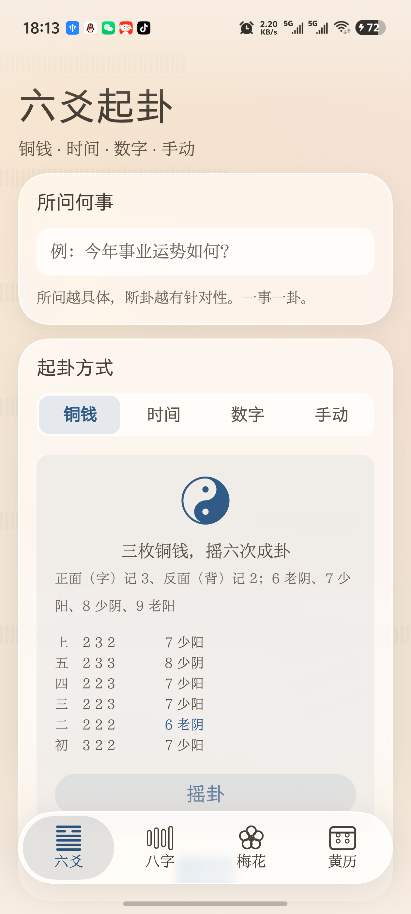
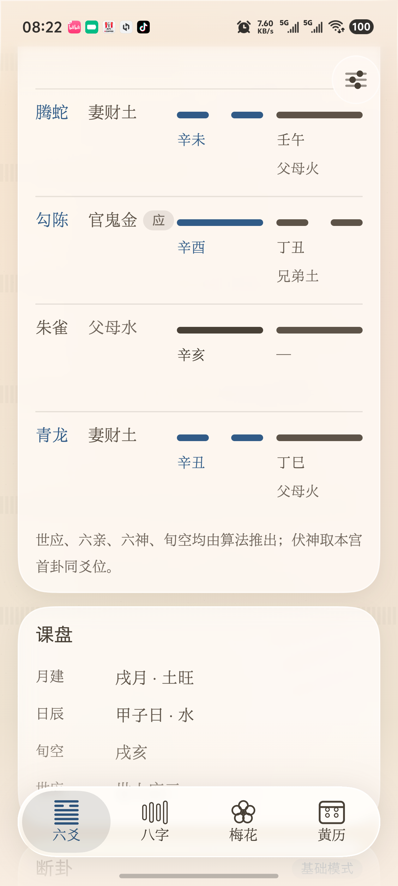
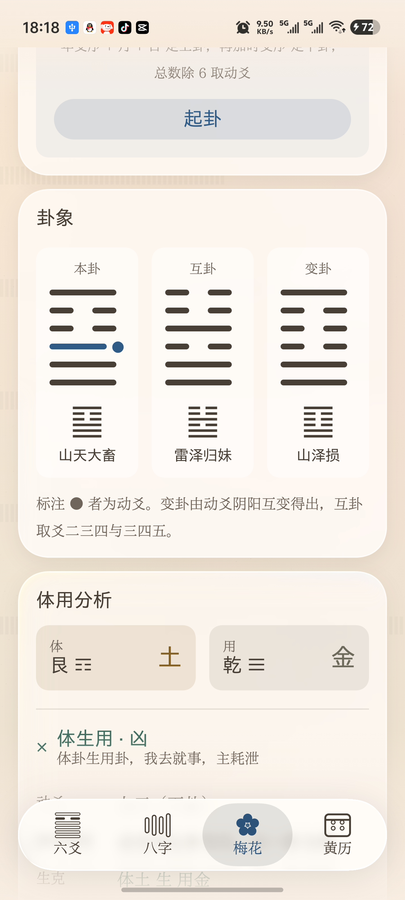
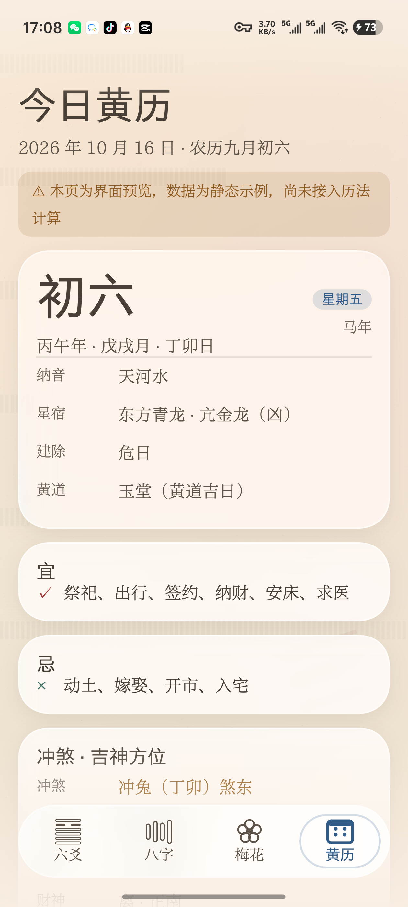
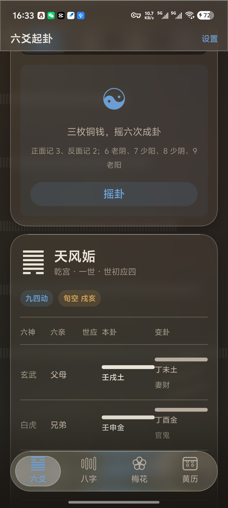
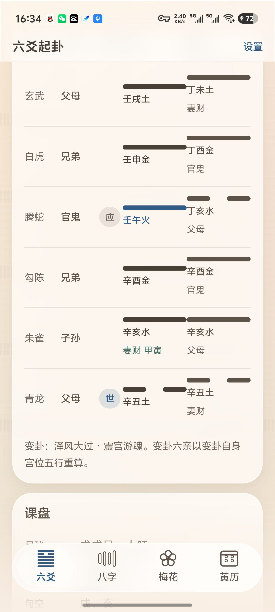
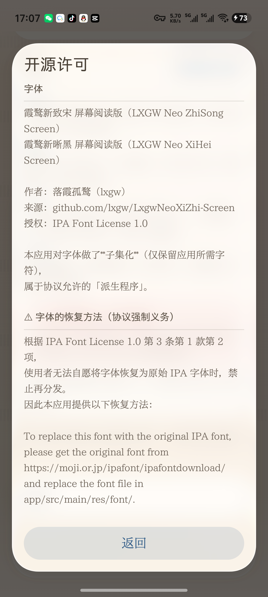

# 猫仙幻术 · 六爻八字梅花黄历

<p align="center">
  
</p>

一款**完全离线**的传统术数工具。六爻起卦、八字排盘、梅花易数、今日黄历，四件事做齐。

界面按 Apple HIG 与 iOS 流体玻璃（Liquid Glass）风格设计，亮暗双主题。
**不联网、不注册、不收集任何数据** —— 所有计算都在手机本地完成。

---

## 它能做什么

### 🔮 六爻起卦

四种起卦方式，随你习惯：

| 方式 | 说明 |
|---|---|
| **铜钱** | 三枚铜钱摇六次。正面记 3、反面记 2，老阴/少阳/少阴/老阳判定，动爻自动标出 |
| **时间** | 按当下时刻起卦。年支序 + 月 + 日定上卦，再加时支序定下卦 |
| **数字** | 随手报两个数，除 8 取余定上下卦，除 6 取余定动爻 |
| **手动** | 直接点爻线指定阴阳与动爻 |

起卦后自动装卦，排出完整卦盘：

- **纳甲**（干支）、**六亲**、**世应**、**六神**、**旬空**
- **伏神** —— 本卦缺哪个六亲，自动从本宫首卦借来
- **变卦** —— 变爻六亲按变卦自身宫位重算
- **旺相休囚死** —— 由月建推出

然后自动断卦：定用神 → 看旺衰 → 看日辰 → 看动爻 → 看变爻 → 看世应 → 看旬空，
**逐条给出依据**，你能看到结论是怎么来的。

每次起卦自动存入本机历史，随时回看。

### 🎋 八字命盘

输入生辰与性别，排出四柱：

- 天干地支、藏干、十神、纳音、地势（长生十二宫）
- 五行分布图
- 大运（顺逆由性别与年干阴阳决定）
- 胎元、命宫、身宫

> 关于八字我们**刻意保守**：只做客观排布与统计，不做用神取用与格局成败推断。
> 命理流派众多、个案差异极大，那类结论不适合由程序给出。

### 🌸 梅花易数

时间起卦或数字起卦，一屏看完三卦：

- **本卦** → **互卦**（中间过程）→ **变卦**（结果）
- **体用分析** —— 动爻所在卦为用、另一卦为体，按五行生克断吉凶
- 互卦取爻二三四与三四五

### 📅 今日黄历

- 农历日期、干支四柱、生肖
- 宜 / 忌
- 冲煞、吉神方位（喜神、福神、财神、阴阳贵神）
- 建除十二神、二十八宿、黄道黑道
- **十二时辰吉凶**（时家黄黑道，每天恰好六吉六凶）
- 神煞、彭祖百忌

---

## 界面

| 六爻起卦 | 卦盘与断卦 | 八字命盘 | 梅花易数 |
|---|---|---|---|
|  |  |  |  |

| 今日黄历 | 深色主题 | 设置 | 开源许可 |
|---|---|---|---|
|  |  |  |  |

### 流体玻璃

界面用 iOS 26/27 的流体玻璃材质：真实折射、渐进模糊、连续曲率圆角。

底部导航栏的**气泡可以用手指直接拖动** —— 按住它左右拖，松手按速度吸附到最近的 Tab，
拖动过程中气泡会随速度横向拉伸。这是「流体」感的真正来源。

设置里还能自己调：

- **玻璃质感** —— 完整 / 简化 / 关闭（省电）
- **折射强度** —— 调高更「液体」
- **表面通透度** —— 调低更通透（会提示可读性风险）

---

## 安装

从 [Releases](https://github.com/MokoKing666/MaoMagic/releases/latest) 下载最新 APK 直接安装。

**系统要求**：Android 13（API 33）及以上。

> 部分功能（折射、色散）依赖 Android 13+ 的图形能力；
> 更低版本上会自动降级为模糊玻璃，不会崩。

---

## 隐私

**这个应用不联网。**

- 没有网络权限，没有账号，没有埋点
- 所有排盘、起卦、解卦都在本机计算
- 历史卦例与设置只存在你自己的手机上
- 卸载即全部清除

---

## 关于准确性

术数内容**仅供传统文化研究与娱乐，不构成任何决策建议**。

关于算法，我们做了这些事来保证正确：

- 64 卦的宫位、世应、纳甲、六亲**全部由京房八宫变爻规则算法生成**，不硬编码 ——
  手写 64 条记录必然出错
- 五行生克、地支冲合三合、旬空等能用算术表达的，一律用算术推导而非查表
- 有 **147 个单元测试 + 全输入空间集成测试**守着（六爻 448 种盘、梅花 384 种盘、
  八字 720 组生辰、历法全年逐日）
- 解卦规则引擎是**纯规则**的：同样的卦象与日辰，永远得到同样的结论，可复现

---

## 已知限制

- **解卦只有「基础模式」**（本地规则引擎）。云端 AI 与端上模型尚未接入，
  降级链接口已就位
- 八字不做格局推断（见上文说明）
- 尚无卦例导出/分享功能

---

## 开源致谢

本项目以 **MIT** 协议开源。

界面所用流体玻璃效果来自 [AndroidLiquidGlass](https://github.com/Kyant0/AndroidLiquidGlass)
（作者 Kyant0，Apache-2.0），连续曲率圆角来自同作者的 [Shapes](https://github.com/Kyant0/Shapes)。
历法计算使用 [lunar](https://github.com/6tail/lunar-java)（MIT）。
正文字体为[霞鹜新致宋 / 霞鹜新晰黑 屏幕阅读版](https://github.com/lxgw/LxgwNeoXiZhi-Screen)（IPA Font License 1.0）。

完整清单见 [THIRD_PARTY_LICENSES.md](THIRD_PARTY_LICENSES.md)，
也可在应用内「设置 → 开源许可」查看。

---

## 开发

技术栈：Kotlin · Jetpack Compose · AGP 9 · 纯 JVM 算法内核。

```bash
./gradlew :app:assembleDebug   # 构建
./gradlew test                 # 跑全部单元测试
bash tools/install-debug.sh    # 构建 + 安装 + 校验设备版本
```

算法内核（`core:model` / `core:hexagram` / `core:calendar` / `core:interpret`）
是**纯 JVM 模块**，零 Android 依赖，因此可以脱离模拟器直接跑单测。

架构决策见 [docs/ARCHITECTURE.md](docs/ARCHITECTURE.md)，
设计约束见 [docs/UI-DESIGN-RULES.md](docs/UI-DESIGN-RULES.md)，
起卦取数规则见 [docs/DIVINATION_RULES.md](docs/DIVINATION_RULES.md)。
