# 猫仙幻术 · 传统术数工具箱

> 可能是 500 万以内最好的开源排盘软件之一。

<p align="center">
  
</p>

一款**完全离线**的传统术数工具。六爻起卦、八字排盘、梅花易数、今日黄历，四件事做齐。

界面按 Apple HIG 与 iOS 流体玻璃（Liquid Glass）风格设计，亮暗双主题。
**默认完全离线** —— 四大模块的排盘、起卦、解卦全部在手机本地完成，
不注册、不收集数据、不发起任何网络请求。

---

## 端上 AI 解卦（本地跑大模型）

**可能是第一个内置端上大模型的开源排盘软件。**

模型跑在你自己手机上，**不联网、不上传**。

### 算归算，说归说

```
规则引擎（确定性算法）  →  用神是谁 / 旺衰如何 / 是否旬空 / 哪爻动
        ↓  已算定的事实，不许改
端上模型 Qwen3.5 0.8B   →  把这些事实讲成人话
```

**AI 不参与任何判断。** 它看到的「已算定」段落是程序的输出，
它写的每一段都只是对既定结论的转述。

为什么这么较真：小模型做多步五行生克并不可靠，会给出「用神旺相」
而实际是「囚」这种听起来对、其实错的结论 —— 而且编得很有说服力。
**让它算，就是在骗用户。**

### 怎么说

解卦的口气学**曾仕强**：像一位讲了一辈子《易经》的老先生，当面跟你讲话，
用家常话讲道理，不端着，也不打官腔。

三条硬规矩，写死在提示词里：

- **有话直说。** 盘面不好就直说不好，讲清楚哪里不好、什么时候最明显、会以什么方式出现。
  「卦里没显示」「因人而异」「仅供参考」「一切随缘」这类推脱话，明确禁止。
- **不用术语。** 世爻、应爻、旬空、用神这些词，一律翻成大白话
  （「你自己这一边」「对方那一边」「眼下使不上劲」「这件事的关键」），输出里不许出现。
- **建议要能落地。** 每条都得能回答「那我明天做什么」，
  不写「保持平和心态」「多沟通」这种空话。

话说直，但不判死：讲「照这么走下去会怎样」，不讲「你命里注定怎样」。

### 模型与运行时

| | |
|---|---|
| 模型 | Qwen3.5 0.8B（int8，**文本版**） |
| 体积 | 约 920 MB，**按需下载，不打包进 APK** |
| 格式 | `.litertlm`（LiteRT-LM 容器） |
| 运行时 | [LiteRT-LM](https://github.com/google-ai-edge/LiteRT-LM) |
| 加速 | **GPU（OpenGL ES）**，无需 OpenCL；NPU 需芯片厂商专有运行时，暂未接入 |

**六爻、梅花、八字、塔罗、小六壬 —— 五个系统全部接入**，不是只有六爻有。

### 四档可选

设置里可以选：**自动 / 基础 / 本地模型 / 云端 AI**。

| 档位 | 联网 | 说明 |
|---|---|---|
| 基础 | 否 | 只用规则引擎，可复现、不占存储 |
| 本地模型 | **否** | 手机自己算，需要那 920 MB |
| 云端 AI | 是 | 把卦盘发给你填的服务，更细腻 |
| 自动 | 视情况 | 优先本地，没下载就退下一档 |

### 不下载也能用

规则引擎始终兜底。不下模型只是文字更朴素，功能一点不少。

## 它能做什么

### 🔮 六爻起卦

四种起卦方式，随你习惯：

| 方式 | 说明 |
|---|---|
| **铜钱** | **一爻一摇、六摇成卦**。三枚方孔铜钱，正面记 3、反面记 2；老阴/少阳/少阴/老阳判定，动爻自动标出。也可以直接**摇手机**起卦，带落桌音效与翻面动画 |
| **时间** | 按当下时刻起卦。年支序 + 月 + 日定上卦，再加时支序定下卦 |
| **数字** | 随手报两个数，除 8 取余定上下卦，除 6 取余定动爻 |
| **手动** | 直接点爻线指定阴阳与动爻 |

起卦后自动装卦，排出完整卦盘：

- **纳甲**（干支）、**六亲**、**世应**、**六神**、**旬空**
- **伏神** —— 本卦缺哪个六亲，自动从本宫首卦借来
- **变卦** —— 变爻六亲按变卦自身宫位重算
- **旺相休囚死** —— 由月建推出
- **节气** —— 月建按节气换，盘面标出当前所处节气（如「寒露」），解释月建为何是这一支

然后自动断卦：定用神 → 看旺衰 → 看日辰 → 看动爻 → 看变爻 → 看世应 → 看旬空，
**逐条给出依据**，你能看到结论是怎么来的。

#### 卦例

每次起卦自动存入本机历史。点开任一卦例，**按记录当时的时间还原日课**
（六爻断卦靠日辰定旺衰，用今天的日辰重算旧卦，结论就错了）。

- **导出 / 导入** —— JSON 格式，走系统文件选择器。换手机不再丢卦例
- **删除需二次确认** —— 单击查看、行尾「删除」、再「确认删除」，三步分开

记录只存本机，不上传任何数据。

### 🎋 八字命盘

输入生辰与性别，排出四柱：

- 天干地支、藏干、十神、纳音、地势（长生十二宫）
- 五行分布图
- 大运（顺逆由性别与年干阴阳决定）
- 胎元、命宫、身宫

> 关于八字我们**刻意保守**：只做客观排布与统计，不做用神取用与格局成败推断。
> 命理流派众多、个案差异极大，那类结论不适合由程序给出。

### 🌸 梅花易数

时间起卦或数字起卦，一屏看完三卦：

- **本卦** → **互卦**（中间过程）→ **变卦**（结果）
- **体用分析** —— 动爻所在卦为用、另一卦为体，按五行生克断吉凶
- 互卦取爻二三四与三四五

### 📅 今日黄历

- 农历日期、干支四柱、生肖
- 宜 / 忌
- 冲煞、吉神方位（喜神、福神、财神、阴阳贵神）
- 建除十二神、二十八宿、黄道黑道
- **十二时辰吉凶**（时家黄黑道，每天恰好六吉六凶）
- 神煞、彭祖百忌

---

## 界面

| 六爻起卦 | 卦盘与断卦 | 八字命盘 | 梅花易数 |
|---|---|---|---|
| 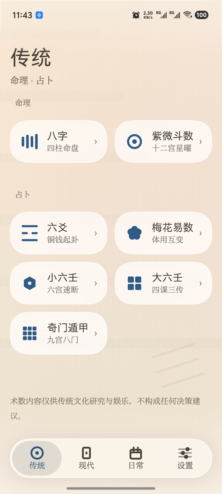 | 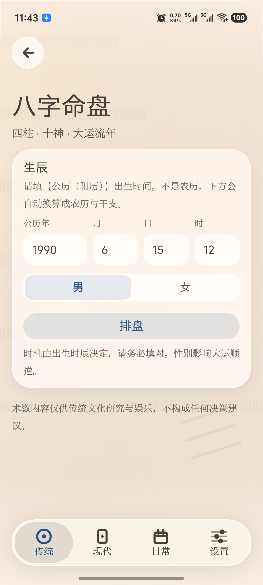 | 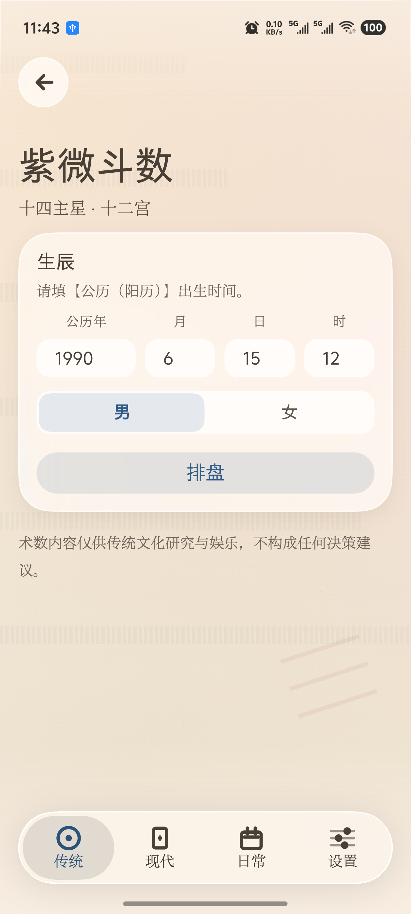 | 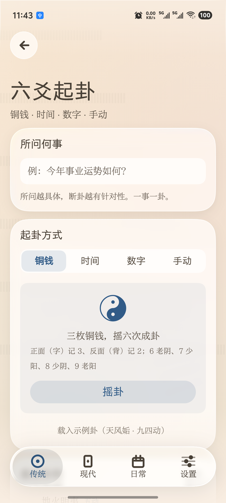 |
| 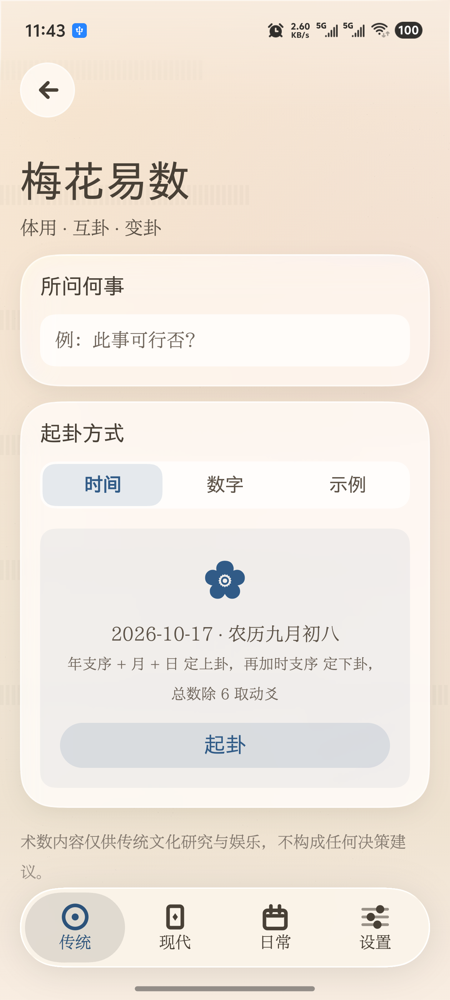 | 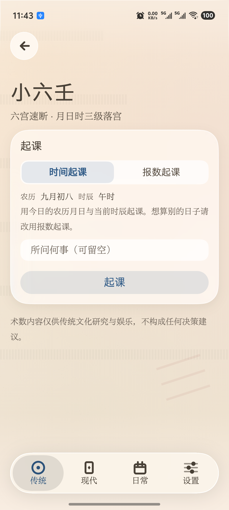 | 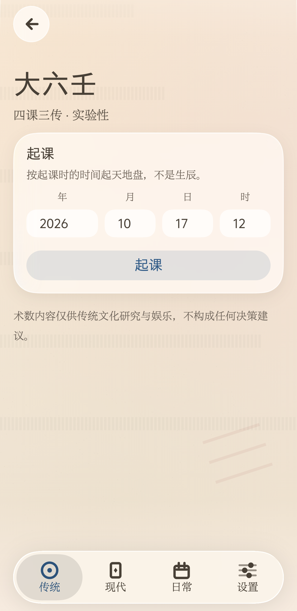 | 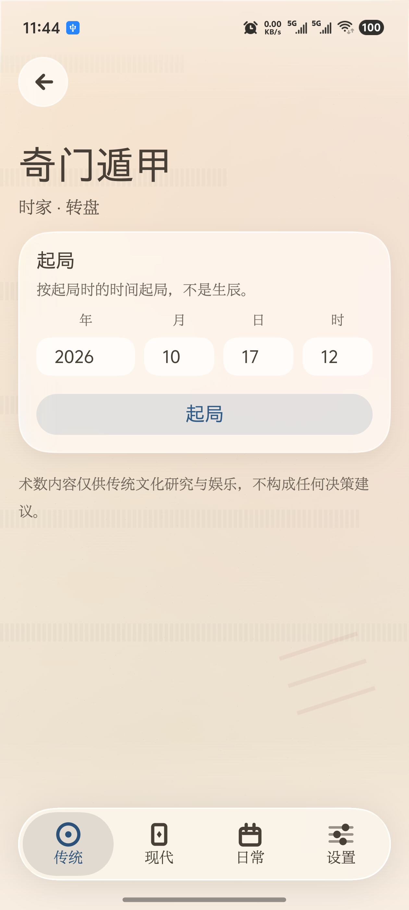 |
| 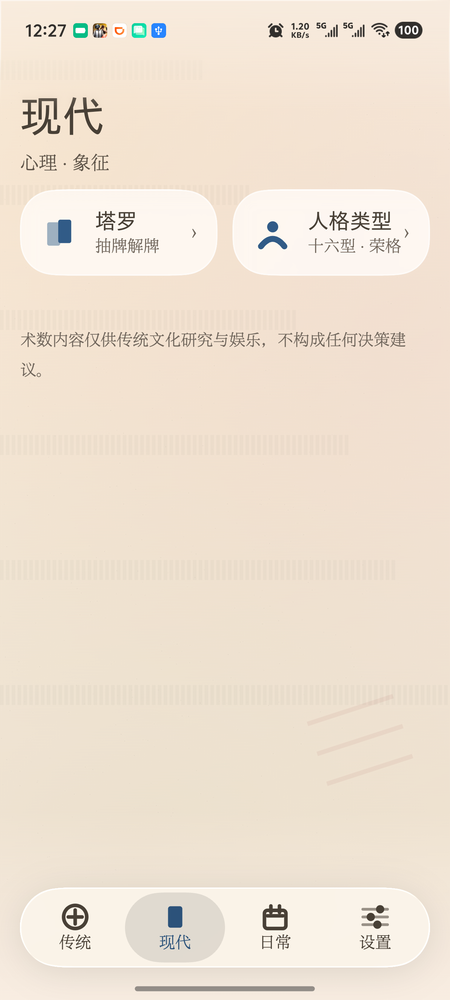 | 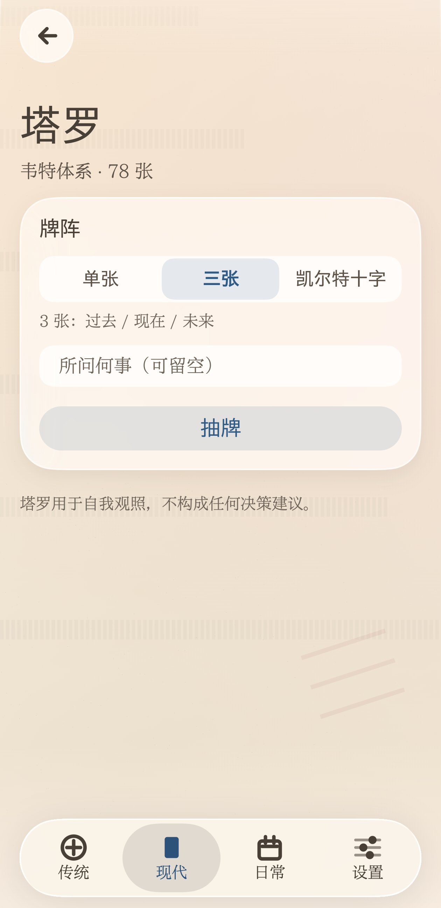 | 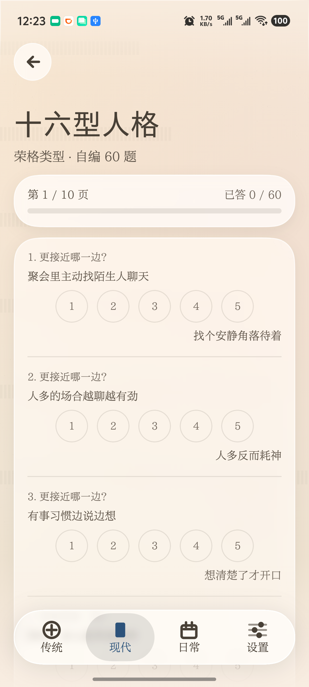 |  |
| 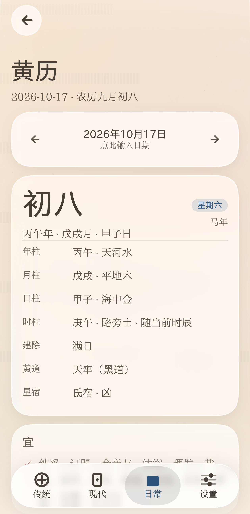 | 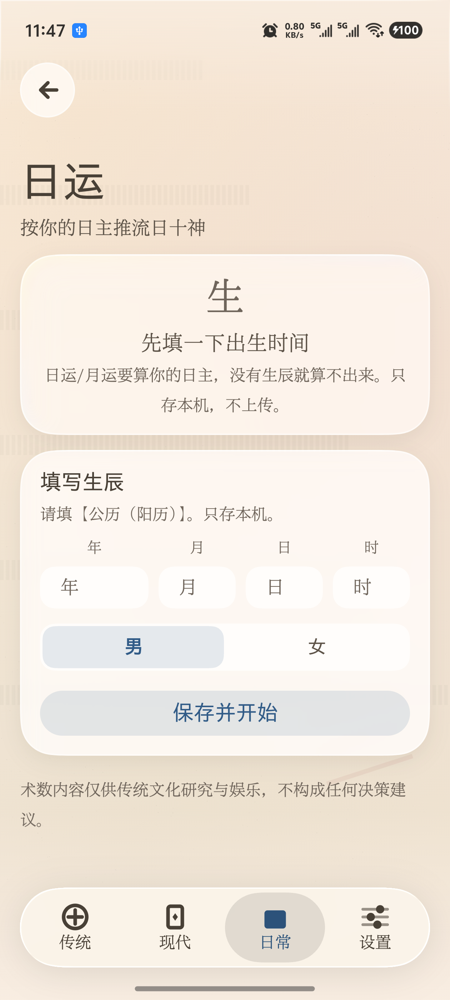 | 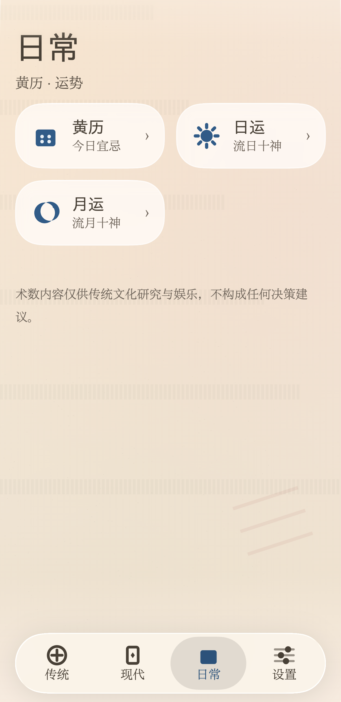 | 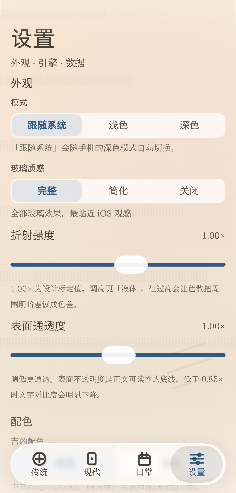 |

| 今日黄历 | 深色主题 | 设置 | 开源许可 |
|---|---|---|---|

### 流体玻璃

界面用 iOS 26/27 的流体玻璃材质：真实折射、渐进模糊、连续曲率圆角。

底部导航栏的**气泡可以用手指直接拖动** —— 按住它左右拖，松手按速度吸附到最近的 Tab，
拖动过程中气泡会随速度横向拉伸。这是「流体」感的真正来源。

设置里还能自己调：

- **玻璃质感** —— 完整 / 简化 / 关闭（省电）
- **折射强度** —— 调高更「液体」
- **表面通透度** —— 调低更通透（会提示可读性风险）

### 卡片长成页面

点板块页的功能卡片，卡片会**连续变形成整页**，而不是直接切页：

- 位置、宽高、圆角、裁剪区同时插值，圆角从 28dp 连续收到 0
- 玻璃材质跟着容器一起移动、缩放、收角，不会「卡片玻璃消失 → 页面重画一块」
- 卡片标题与页面大标题共用一条共享边界，字号连续长大
- 返回时沿原路径缩回原始卡片，列表滚动位置保留

用的是 Compose 官方共享元素 API（`SharedTransitionLayout` / `Modifier.sharedBounds`），
实现细节见 [docs/CONTAINER-TRANSFORM.md](docs/CONTAINER-TRANSFORM.md)。

普通 Tab 切换、设置页这类没有来源卡片的导航仍走淡入淡出 —— 不硬套卡片缩放。

---

## 安装

从 [Releases](https://github.com/MokoKing666/MaoMagic/releases/latest) 下载最新 APK 直接安装。

**系统要求**：Android 13（API 33）及以上。

> 部分功能（折射、色散）依赖 Android 13+ 的图形能力；
> 更低版本上会自动降级为模糊玻璃，不会崩。

---

## 配置要求

### 基础模式（不用 AI）

| | |
|---|---|
| 系统 | Android 13 及以上（minSdk 33） |
| 架构 | arm64-v8a |
| 存储 | 约 60 MB |
| 内存 | 3 GB 以上 |

**任何能装 Android 13 的手机都跑得动。** 不下载模型就永远用这一档。

### 本地模型（端上 AI）

| | |
|---|---|
| 系统 | Android 13+ |
| 架构 | arm64-v8a（x86 模拟器不支持） |
| **内存** | **4 GB 以上**，6 GB 以上更稳 |
| 存储 | 约 1.2 GB 可用空间（模型 920 MB + 余量） |
| GPU | **无需 OpenCL** —— 走 OpenGL ES，Adreno / Mali 均可 |

**门槛是「内存 + 算力」两件事，缺一不可。**

内存够不等于能跑 —— 一台 16 GB 内存的入门 SoC（比如 4×A53 + Mali-T720）
内存绰绰有余，但算力差两个数量级，一个 token 要几秒，实际等于不可用。

能不能用，由四件事决定：

1. **内存**：模型文件 920 MB，加载后常驻约 1.3–1.6 GB（估算，未逐台实测）
2. **GPU 算力**：需要 **OpenGL ES 3.1 + 计算着色器**。
   这是硬门槛 —— 低于此版本连 GPU 后端都起不来
3. **SoC 档次**：下面那张表是「大致下限」，低于它基本不可用
4. **系统版本**：Android 13+

> 说「大致」是因为 GPU 驱动质量、散热、系统调度都会影响实际速度，
> 同代芯片之间也可能差一倍。**唯一可靠的判断是实测。**

### 大致的机型参照

下表只是「大概在哪一档」的经验参考，**不是保证**。
以 App 运行时的实际探测为准 —— 它会真的去初始化各后端，
比按型号推断可靠。

| 平台 | 大致下限 |
|---|---|
| 高通骁龙 | 865 以上 |
| 联发科天玑 | 1000 以上 |
| 三星 Exynos | 990 以上 |
| 华为麒麟 | 9000 以上（HarmonyOS NEXT 装不了 APK） |
| Google Tensor | 全系 |
| 紫光展锐 | T820 以上 |

> 为什么给「以上」而不是列型号：这个区间往后出什么新芯片都不用改文档。
> 也因为**我并没有逐台验证过**——只实测了天玑 9400 一台，
> 写死型号会让人误以为那是测过的结论。

### 速度参考

| 来源 | 设备 | 后端 | 速度 |
|---|---|---|---|
| 模型作者在模型卡公布 | Galaxy S26 | GPU | decode 35 tok/s · prefill 551 tok/s · 首字 400 ms |

> 这是**模型作者**的实测数字，不是我在本项目里测的。
> 换模型后没有重测，所以上一版那张 Gemma 的耗时表已经删掉了 ——
> 留着只会误导。加速走 **OpenGL ES**，Android 上人人都有，**不依赖 OpenCL**。

### 为什么门槛不低

模型文件 920 MB，加载后常驻约 1.3–1.6 GB。内存不够时系统会杀进程，
表现是「点了没反应」，而不是报错。

所以**不满足条件时默认走基础模式** —— 规则引擎始终可用，功能一点不少，
只是文字更朴素。这是刻意的：宁可少一点文采，也不让用户装完发现不能用。

## 隐私

**默认完全离线，不会发起任何网络请求。**

- 没有账号、没有埋点、没有统计、没有广告 SDK
- 四大模块的排盘、起卦、解卦全部在本机计算
- 历史卦例与设置只存在你自己的手机上，卸载即全部清除

### 关于网络权限

APK **声明了 `INTERNET` 权限** —— 这一点如实说明，因为可选功能「智能模式」需要它。

- **默认关闭。** 不开启时应用不会产生任何网络流量，全部功能照常可用
- 开启需要你**同时**填好三样东西：服务地址、API Key、模型名。三者缺一即自动回到基础模式
- 请求**只发往你自己填的地址**，不预置任何服务商，我们不经手任何数据
- 发送内容**只有卦盘和你问的问题**，不含设备标识、位置或账号信息
- API Key 用 Android Keystore 加密存在本机，不上传
- 随时关掉开关，立刻恢复完全离线

一句话：**基础模式永远是本地的；联网只在你自己主动开启时才发生。**

---

## 关于准确性

术数内容**仅供传统文化研究与娱乐，不构成任何决策建议**。

关于算法，我们做了这些事来保证正确：

- 64 卦的宫位、世应、纳甲、六亲**全部由京房八宫变爻规则算法生成**，不硬编码 ——
  手写 64 条记录必然出错
- 五行生克、地支冲合三合、旬空等能用算术表达的，一律用算术推导而非查表
- 有 **147 个单元测试 + 全输入空间集成测试**守着（六爻 448 种盘、梅花 384 种盘、
  八字 720 组生辰、历法全年逐日）
- 解卦规则引擎是**纯规则**的：同样的卦象与日辰，永远得到同样的结论，可复现

---

## 已知限制

- **解卦只有「基础模式」**（本地规则引擎）。云端 AI 与端上模型尚未接入，
  降级链接口已就位
- 八字不做格局推断（见上文说明）
- 尚无卦例导出/分享功能

---

## 开源致谢

本项目以 **MIT** 协议开源。

界面所用流体玻璃效果来自 [AndroidLiquidGlass](https://github.com/Kyant0/AndroidLiquidGlass)
（作者 Kyant0，Apache-2.0），连续曲率圆角来自同作者的 [Shapes](https://github.com/Kyant0/Shapes)。
历法计算使用 [lunar](https://github.com/6tail/lunar-java)（MIT）。
正文字体为[霞鹜新致宋 / 霞鹜新晰黑 屏幕阅读版](https://github.com/lxgw/LxgwNeoXiZhi-Screen)（IPA Font License 1.0）。

完整清单见 [THIRD_PARTY_LICENSES.md](THIRD_PARTY_LICENSES.md)，
也可在应用内「设置 → 开源许可」查看。

---

## 开发

技术栈：Kotlin · Jetpack Compose · AGP 9 · 纯 JVM 算法内核。

```bash
./gradlew :app:assembleDebug   # 构建
./gradlew test                 # 跑全部单元测试
bash tools/install-debug.sh    # 构建 + 安装 + 校验设备版本
```

算法内核（`core:model` / `core:hexagram` / `core:calendar` / `core:interpret`）
是**纯 JVM 模块**，零 Android 依赖，因此可以脱离模拟器直接跑单测。

架构决策见 [docs/ARCHITECTURE.md](docs/ARCHITECTURE.md)，
设计约束见 [docs/UI-DESIGN-RULES.md](docs/UI-DESIGN-RULES.md)，
起卦取数规则见 [docs/DIVINATION_RULES.md](docs/DIVINATION_RULES.md)，
神煞取法的分档与待确认项见 [docs/神煞取法.md](docs/神煞取法.md)。

## 数据与文本来源

本项目的文本内容分三类，来源与许可各不相同：

| 内容 | 来源 | 许可 |
|---|---|---|
| 历法、干支、八字、黄历、节气 | [lunar](https://github.com/6tail/lunar-java) | MIT |
| 六爻装卦、64 卦名、梅花、小六壬、八字/日运/月运断语 | 本项目自研（算法生成或自撰） | MIT |
| 塔罗 78 张牌义 | 依 A. E. Waite《The Pictorial Key to the Tarot》(1911) 译写 | 该著作已进入**公有领域** |
| 十六型人格题库与类型描述 | 本项目自编（依荣格类型理论） | MIT |

### 关于塔罗

韦特-史密斯牌组（1909）的画面与体系已进入公有领域，本项目据此译写牌义。
**未使用**任何现代塔罗出版物（如 Pollack《Seventy-Eight Degrees of Wisdom》、
Mary K. Greer 的教学体系、Joan Bunning 的在线资料）的文字 —— 这些均受版权保护，
且「免费公开」不等于「可自由复用」。

本项目也未做「如有侵权请联系删除」一类的声明：该声明在中国法律下不产生免责效力，
且书面承认明知风险在赔偿裁量中属加重情节而非减轻。MIT 协议允许再分发，
因此上游若含侵权内容，风险会转移给每一位下游使用者 —— 所以从一开始就不引入。

### 关于十六型人格

**不是 MBTI®。** MBTI 是 The Myers-Briggs Company 的注册商标，官方问卷需付费授权。
**也不是 NERIS Type Explorer®**（16Personalities 的专有模型，五维、多一个 A/T 维度，
其官网明确写着 "not the official MBTI®"）。

本项目的 60 道题与 16 型描述均为自编，类型别称亦自起（不沿用 16Personalities 的
「建筑师」「提倡者」等品牌化命名）。

另需说明：四维类型把连续倾向切成两类，落在中间的人结果本就不稳定，
相当比例的人隔几周重测会得到不同类型。这是该框架本身的边界，不是测量误差。
