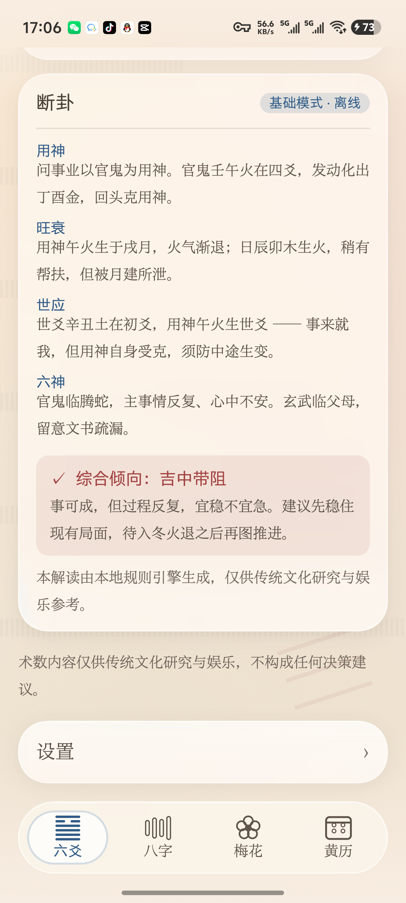

# 猫仙幻术 · MaoXianHuanShu

> 一款开源的中国传统术数排盘与解卦工具
> 八字 · 六爻 · 梅花易数 · 黄历

[](LICENSE)
[]()
[]()
[]()

---

## ⚠️ 免责声明

本项目是**中国传统术数文化的数字化研究与娱乐工具**。

- 所有排盘结果与解读内容**仅供传统文化研究与娱乐参考**
- **不构成**任何决策、医疗、法律、投资、婚恋建议
- 请勿将输出结果用于任何重大人生决策
- 本项目不做「预测吉凶祸福」「改运」「消灾」等功效宣称，不提供付费算命服务

详见 [PRIVACY.md](PRIVACY.md)。

---

## 界面

| 六爻起卦 | 八字命盘 | 梅花易数 | 今日黄历 |
|---|---|---|---|
|  |  |  |  |

| 页面末尾设置入口 | 设置 | 深色主题 | 开源许可 |
|---|---|---|---|
|  |  |  |  |

> **当前进度：算法内核与四个模块的功能已全部接线完成。**
> 六爻（四方式起卦 → 装卦 → 卦盘 → Tier1 解卦 → 历史卦例）、
> 八字（排盘 → 四柱/五行/大运）、梅花（起卦 → 三卦 → 体用）、黄历（今日日课）
> 均已接入真实计算，**离线可用、零网络依赖**。
>
> **尚未完成**：Tier2 云端 AI / Tier3 端上模型（降级链接口已就位，仅缺实现）、
> 设置的持久化、卦例导出。
>
> **测试**：141 个单测 + 全输入空间集成测试（六爻 448 盘 / 梅花 384 盘 /
> 八字 720 组 / 历法全年逐日），`./gradlew test` 全绿。

设计约束（不是审美偏好，是可验证的规则）：

- **可读性高于一切** —— 玻璃表面不透明度 0.62 是实测底线，低于它正文对比度会跌破 4.5:1
- **深色主题的表面必须用「白抬升」，绝不能用黑** —— 黑叠在暗背景上会让卡片比背景更暗，
  读作「挖了个洞」。亮色靠「遮」、深色靠「抬」，两者机制不同，数值不可互换
- **只允许两层玻璃，且不得相邻嵌套**（No Glass on Glass）—— 卡片内部的控件一律实心填充
- **同心圆角** —— `r_child = r_parent − padding`，圆心必须重合
- **圆角用连续曲率**（`MagicSmoothCornerShape`），不用正圆弧
- **`lens()` 的折射量必须夹到元素短边的 1/4** —— 否则色散会把周围明暗差读成色差，整片发灰蓝
- **吉凶一律「颜色 + 字形」双通道** —— 颜色永远不单独承载语义
- **背景必须低饱和且有细节** —— 玻璃靠折射背景成立，纯色背景上做玻璃等于没做
- **宋体正文 + 黑体标题**，层级不建立在 `fontWeight` 上（单字重字体合成加粗会糊）

字体采用 **霞鹜新致宋 / 霞鹜新晰黑 屏幕阅读版**（子集化后 3.00 MB + 1.83 MB，
0 汉字缺失、0 卦符缺失）。该字体为 **IPA Font License 1.0**，
App 内已按协议要求提供全文与恢复原始字体的方法，见 [THIRD_PARTY_LICENSES.md](THIRD_PARTY_LICENSES.md#3-字体ipa-font-license-10--有强制义务)。

详见 [docs/UI-DESIGN-RULES.md](docs/UI-DESIGN-RULES.md)。

---

## 功能

### 一、八字排盘
四柱干支、藏干、十神（含藏干十神）、大运、流年、五行旺衰统计、神煞。

### 二、六爻起卦解卦
- **四种起卦方式**：铜钱摇卦（三枚铜钱六次）、时间起卦、数字起卦、手动逐爻指定
- **自动装卦**：纳甲、六亲、六神、世应、伏神、空亡
- **变卦 / 互卦**推演
- 断卦提示（Tier1 规则引擎）

### 三、梅花易数
时间起卦、数字起卦、报字起卦；体用分析、互卦、变卦、五行生克（用生体 / 体用比和 / 体克用 / 体生用 / 用克体）。

### 四、黄历择日 + 每日运势
每日宜忌、吉神凶煞、冲煞、彭祖百忌、吉神方位、时辰吉凶。

### 五、iOS 流体玻璃 UI
基于 [Backdrop](https://github.com/Kyant0/AndroidLiquidGlass)（Apache-2.0）实现的 Liquid Glass 全局玻璃化界面：模糊、透镜折射、色散、深度效果。亮/暗双主题，Apple HIG 风格。

---

## 三档解卦引擎

这是本项目与同类工具最大的差异点：**解卦能力分层，离线永远可用**。

| 档位 | 实现 | 是否默认 | 依赖 |
|---|---|---|---|
| **Tier 1** | 本地规则引擎（五行生克 + 卦辞库） | ✅ 默认开启 | 无。零网络、零模型，必定可用 |
| **Tier 2** | 云端 AI（OpenAI 兼容 API） | ❌ 需手动配置 | 用户自填 BaseURL + API Key |
| **Tier 3** | 端上本地模型（LiteRT-LM） | ❌ 需手动下载 | 用户自行下载模型文件 |

**降级链**：Tier3 → Tier2 → Tier1。任何一档不可用（未下载模型、未配 Key、断网、Key 失效、推理失败）都会自动降级，**最终必定落到 Tier 1**，不会出现「解不出来」的情况。

可在设置页切换：`AUTO` / `CLOUD_FIRST` / `LOCAL_FIRST` / `OFFLINE_ONLY`。

### 关于模型文件

**本仓库与 APK 均不包含任何模型权重文件。**

- 仓库通过 `.gitignore` 排除 `*.gguf` `*.litertlm` `*.tflite` `*.onnx` `*.task` `*.safetensors` 及 `models/` 目录
- 用户需在 App 内按需下载模型（含 SHA-256 校验）
- 模型清单见 [`models_manifest.json`](models_manifest.json)，其中每个模型条目的许可条款由模型发布方单独约定，与本项目 MIT 协议无关

---

## 构建

### 环境要求

| 项 | 版本 |
|---|---|
| JDK | 21 |
| Android SDK Platform | 37 |
| Android Build Tools | 36.0.0 |
| Gradle | 9.7.1（wrapper 自带） |
| AGP | 9.4.1 |
| Kotlin | 2.4.21 |
| 最低运行版本 | Android 13（API 33） |

### 步骤

```bash
git clone <repo-url>
cd MaoXianHuanShu

# 指向本机 Android SDK
echo "sdk.dir=/path/to/Android/Sdk" > local.properties

# 构建 debug APK
./gradlew assembleDebug
```

产物：`app/build/outputs/apk/debug/app-debug.apk`

### 跑算法内核单测

核心算法层是**纯 JVM 模块**（零 Android 依赖），单测无需设备、无需 SDK Platform：

```bash
./gradlew :core:calendar:test :core:hexagram:test :core:interpret:test
```

---

## 架构

```
MaoXianHuanShu/
├── app/                    Android 外壳、导航、DI 装配
├── core/
│   ├── model/              纯 JVM · 领域模型（零依赖）
│   ├── calendar/           纯 JVM · 历法 + 八字 + 黄历
│   ├── hexagram/           纯 JVM · 64卦 + 六爻装卦 + 梅花   ★技术核心
│   ├── interpret/          纯 JVM · 解卦引擎抽象 + Tier1 规则引擎
│   ├── ai/                 Android · Tier2 云端 + Tier3 LiteRT-LM
│   └── data/               Android · DataStore 设置 / 历史 / Key 加密
├── designsystem/           Android · Apple HIG + 流体玻璃设计系统
└── feature/
    ├── bazi/  liuyao/  meihua/  almanac/
```

**关键设计决策**

1. **算法层与 Android 完全解耦** —— `core:model` / `core:calendar` / `core:hexagram` / `core:interpret` 是 `java-library` 纯 JVM 模块，内部禁止任何 `android.*` 导入。收益：单测秒级跑完、CI 不依赖 SDK Platform、算法可复用到 CLI 或桌面端。

2. **64 卦表由算法生成，不硬编码** —— 按京房八宫变爻规则在初始化时生成全表并做 `check(size == 64)` 自检。手写 64 条记录极易出错，这是本项目最重要的正确性保障。

3. **唯一根 backdrop** —— 全局只建一个 `LayerBackdrop`，所有玻璃表面共享，避免多层嵌套导致的性能崩塌与渲染崩溃。

详见 [docs/ARCHITECTURE.md](docs/ARCHITECTURE.md)。

---

## 算法正确性

六爻装卦是本项目技术难度最高的部分。我们采用**黄金测试**保障准确性：

| 测试项 | 内容 |
|---|---|
| 八宫卦序 | 64 卦全部归宫与卦序（本宫/一世…五世/游魂/归魂） |
| 世应全表 | 64 卦世爻位与应爻位 |
| 纳甲全表 | 八纯卦纳甲，以及由内外卦拼装出的 64 卦纳甲 |
| 伏神 | 天风姤（乾宫金）六亲缺妻财 → 妻财甲寅伏于第二爻之下 |
| 空亡 | 六旬旬空全表（甲子旬空戌亥 … 甲寅旬空子丑） |
| 归宫陷阱 | 水天需属坤宫游魂、地水师属坎宫归魂 |

起卦取数规则（时间/数字/报字）集中定义并文档化于 [docs/DIVINATION_RULES.md](docs/DIVINATION_RULES.md)，方便社区讨论与替换。

---

## 隐私

- 不收集任何个人身份信息，无需注册账号
- 排盘与历史记录**仅存储在本地设备**
- 云端 AI **默认关闭**；启用后请求直接发往用户自填的第三方服务，本项目不中转、不留存
- API Key 使用 Android Keystore 加密存储，不入库、不入日志
- 无广告 SDK、无统计 SDK

详见 [PRIVACY.md](PRIVACY.md)。

---

## 第三方组件

| 组件 | 用途 | 许可 |
|---|---|---|
| [cn.6tail:lunar](https://github.com/6tail/lunar-java) | 历法内核 | MIT |
| [io.github.kyant0:backdrop](https://github.com/Kyant0/AndroidLiquidGlass) | 流体玻璃效果 | Apache-2.0 |
| AndroidX / Jetpack Compose / Kotlin / OkHttp | 基础设施 | Apache-2.0 |

完整声明见 [THIRD_PARTY_LICENSES.md](THIRD_PARTY_LICENSES.md)。

---

## 贡献

欢迎提交 Issue 与 PR，尤其是：

- 六爻/八字/梅花算法中发现的**准确性错误**（请附古籍出处或权威依据）
- 新的黄金测试用例
- 起卦取数规则的流派讨论
- UI/无障碍改进

请先阅读 [CONTRIBUTING.md](CONTRIBUTING.md)。

---

## 许可

[MIT](LICENSE) © 2026 猫仙幻术 contributors

本项目仅供学习、研究与娱乐使用。
